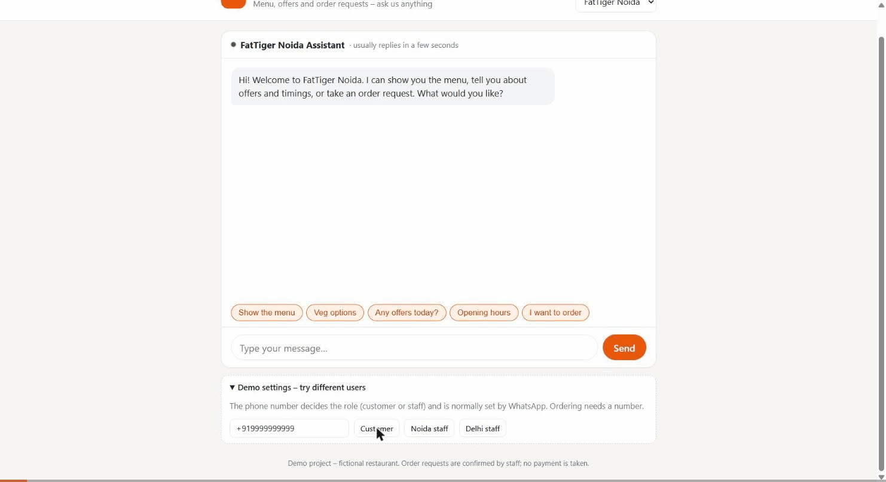
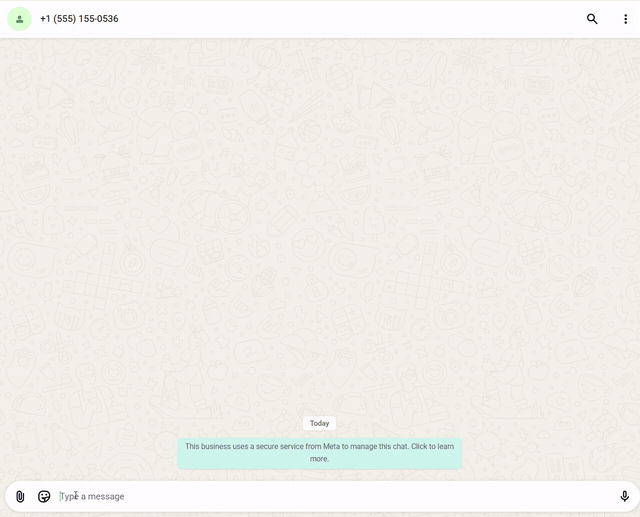
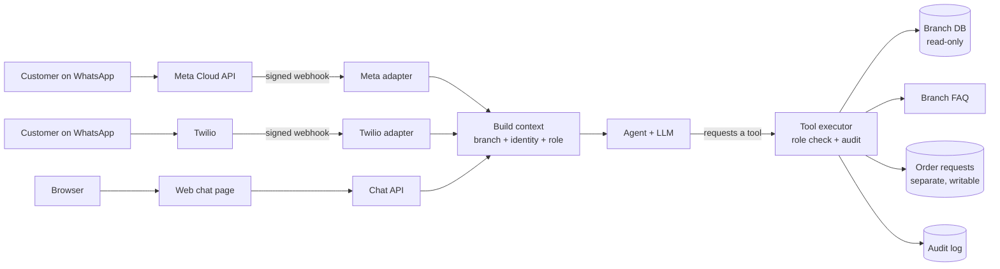

# Restaurant WhatsApp Assistant – multi-branch AI ordering bot

*Web demo: a customer browses veg options and places an order request → Noida staff see it →
Delhi staff can't touch it (branch isolation) → Noida staff confirm it.*

<b>▶ The same bot on real WhatsApp</b> (Meta Cloud API)

*Veg options from the menu → today's offer from the branch FAQ → an order quote (INR 420) →
"yes" → the request is submitted and pending staff confirmation.*

---

An AI assistant for a restaurant chain with several branches. Customers browse the menu, ask
questions and **place order requests** on **WhatsApp** (official Meta Cloud API, or Twilio) or on a
**web chat page**. Staff check stock and manage incoming orders from the same chat.

One deployment serves every branch. Each branch has its own database, its own WhatsApp number and
its own FAQ, and **a customer or staff member of one branch can never see another branch's data**
unless the configuration explicitly allows it.

> Demo data: two branches of a fictional momo and pizza shop, *FatTiger Noida* and *FatTiger Delhi*.

## What it can do

| Who | Can do | Example |
|---|---|---|
| Customer | browse the menu by category or veg only, find dishes by name | "What veg pizzas do you have?", "Anything with paneer?" |
| | see if a dish is available (sold out or not – never the stock count) | "Can I get a Masala Lemonade?" |
| | ask FAQs: timings, delivery area and charges, offers, allergens, payment, seating | "Any offers today?", "I'm allergic to nuts" |
| | place an **order request** (quote → confirm) | "2 steamed momos and a cold coffee" → "yes" |
| Staff | everything above **plus** live stock counts | "How many Margherita pizzas are left?" |
| | see pending order requests and sold-out items | "Any new orders?", "What's sold out?" |
| | confirm or reject an order request | "Confirm order 3" |
| Noida staff | stock at the Delhi branch (explicit cross-branch permission) | "Does the Delhi shop have steamed momos?" |

The role is decided by the sender's phone number, looked up in **that branch's** contacts – never by
anything the user types.

### How ordering works

1. The customer names dishes; the bot finds them on the menu and asks for a quote.
2. Prices and the total come **from the database**, computed in code – the AI only passes item codes
   and quantities, so "2 momos at ₹1 each" still costs the real price.
3. The customer says "yes" → **exactly that quote** is saved as a *pending* request, and the bot
   replies with the request number.
4. Staff see it in their chat and confirm or reject it. No payment is taken – the branch follows up.

## Architecture

- **Channel adapters** turn each provider's format into one internal message – the AI, tools and
  branch logic are shared by every channel.
- **Routing**: the WhatsApp number a message was sent *to* decides the branch. Adding a branch is a
  configuration change, not a code change.
- **The AI only requests tools** – code decides whether the caller's role may run them, and logs
  every call.

## Security

- **Webhook authentication** – Meta and Twilio request signatures are verified before anything runs;
  fail closed.
- **Read-only branch data**, enforced in three independent layers (read-only connection, database
  query-only mode, and an authorizer that rejects any write).
- **Safe writes** – order requests live in a separate database. Prices, totals, phone number and
  branch come from the database and the request context, never from the AI; items and quantities are
  validated in code.
- **Object-level authorization** – staff can only list and update their **own** branch's orders, so
  guessing another branch's order number finds nothing.
- **Role-based tools** – filtered per role and re-checked at execution time; customers never see
  stock counts or other customers' orders.
- **Audit log** of every tool call (branch, masked phone, role, tool, outcome, channel).
- **Secrets** only in environment variables; webhook de-duplication against provider retries.

## Tech stack

Python · FastAPI · SQLite · OpenAI (tool calling, swappable provider) · Meta WhatsApp Cloud API ·
Twilio · deployed on Render

---

**Source code is private.** I'm happy to give a live walkthrough or discuss building something
similar for your business – reach out on LinkedIn.
